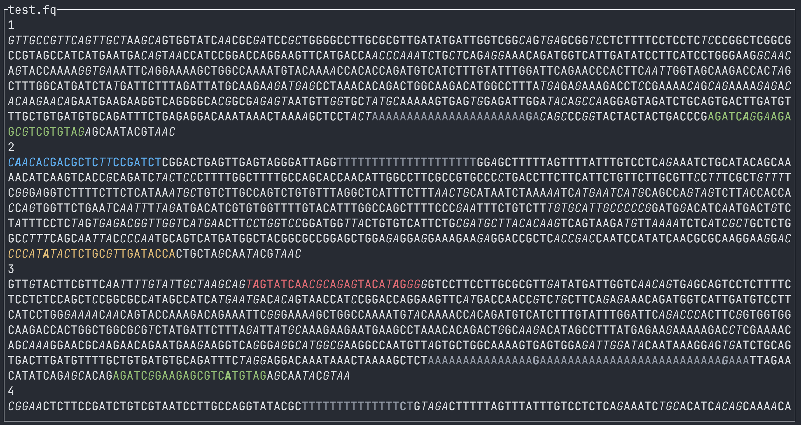
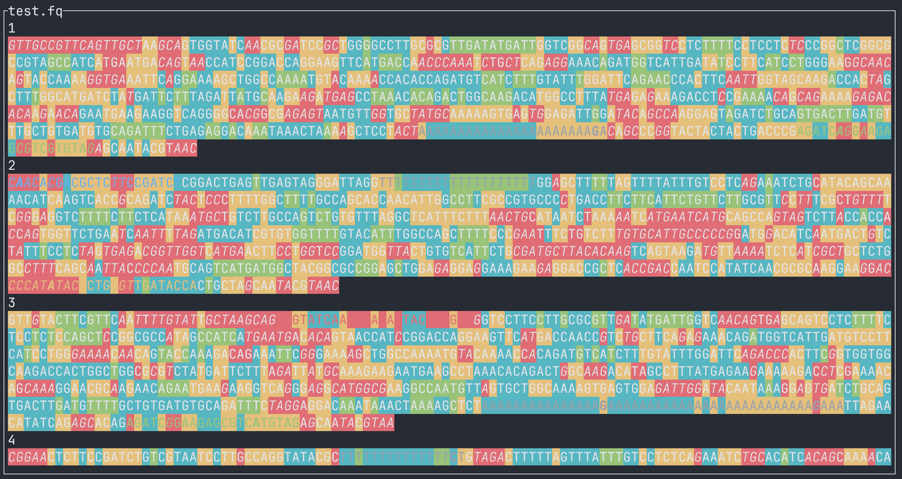
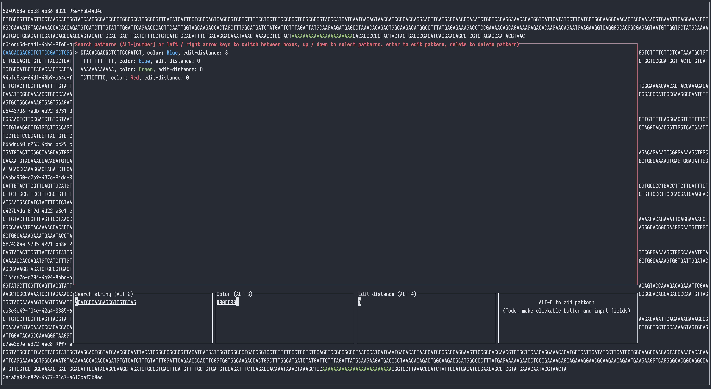

`seqsizzle` is a pager for viewing FASTQ and FASTA files with fuzzy matching, allowing different adaptors to be colored differently.  


# Installation

### Pre-built binary

[](https://github.com/ChangqingW/SeqSizzle/actions/workflows/rust.yml)  
You can simply download and run the binary from [Github Actions](https://github.com/ChangqingW/SeqSizzle/releases/latest).

### Conda

seqsizzle is also available on [bioconda](https://bioconda.github.io/recipes/seqsizzle/README.html):
```
conda install -c bioconda -c conda-forge seqsizzle
```

### Cargo (crates.io)

[](https://crates.io/crates/seqsizzle)
[](https://crates.io/crates/seqsizzle)  
If you already have [a Rust environment set up](https://rustup.rs), you can use the `cargo install` command:
```
cargo install seqsizzle
```
Cargo will build the `seqsizzle` binary and place it in `$HOME/.local/share/cargo/bin/seqsizzle`.

### Cargo (git)

If you already have a Rust environment set up, you can use the `cargo install` command in your local clone of the repo:
```
git clone https://github.com/ChangqingW/SeqSizzle
cd SeqSizzle
cargo install --path .
```
Cargo will build the `seqsizzle` binary and place it in `$HOME/.cargo`.

# Usage
`seqsizzle -h`:
```
A pager for viewing FASTQ and FASTA files with fuzzy matching, allowing different adaptors to be colored differently.

Usage: seqsizzle [OPTIONS] <FILE> [COMMAND]

Commands:
  summarize  Summarize the reads with patterns specified by the --patterns argument or the adapter flags. Make sure you supply the flags BEFORE the subcommand, e.g. `./seqsizzle my.fastq -p my_patterns.csv --adapter-3p summarize`. '..' indicats unmatched regions of positive length, '-' indicates the patterns are overlapped. Prints, for each pattern combination, a cumulative and an exact value in TSV format (three columns; with --counts the values are read counts, otherwise percentages of reads): cumulative_count/cumulative_percent, exact_count/exact_percent, and pattern_combination. The exact value is the number of reads matching that exact combination; the cumulative value also adds the counts of every longer combination that contains it as a contiguous block. Rows are sorted by the exact value. To be moved to the UI in the future
  enrich     Find enriched k-mers in the reads. This can be used to identify potential adapter/primer sequences
  help       Print this message or the help of the given subcommand(s)

Arguments:
  <FILE>  The FASTQ or FASTA file to view (supports .fastq, .fasta, .fa, .fq and their .gz variants)

Options:
      --adapter-3p
          Start with 10x 3' kit adaptors:
           - Patrial Read1: CTACACGACGCTCTTCCGATCT (and reverse complement)
           - Partial TSO: CCCATGTACTCTGCGTTGATACCA (and reverse complement)
           - Poly(>10)A/T
      --adapter-5p
          Start with 10x 5' kit adaptors
           - Patrial Read1: CTACACGACGCTCTTCCGATCT (and reverse complement)
           - Patrial Read2: AGATCGGAAGAGCACACGTCTGAA (and reverse complement)
           - TSO: TTTCTTATATGGG (and reverse complement)
           - Poly(>10)A/T
  -p, --patterns <PATTERNS_PATH>
          Start with patterns from a CSV file
          Must have the following header:
          pattern,color,editdistance,comment
  -s, --save-patterns <SAVE_PATTERNS_PATH>
          Save the search panel to a CSV file before quitting. To be removed in the future since you can now hit Ctrl-S in the search panel to save the patterns
      --quality-italic
          Enable italic styling for low quality bases (enabled by default)
      --no-quality-italic
          Disable italic styling for low quality bases
      --quality-threshold <QUALITY_THRESHOLD>
          Quality threshold for styling [default: 10]
      --quality-colors
          Enable background color styling based on quality scores. You will probably have a hard time distinguishing forground colors from background colors, so this is disabled by default
  -h, --help
          Print help
  -V, --version
          Print version
```
## Navigation
### Viewer mode

Up / down arrow (or `j` / `k`) to scroll by one line, `Ctrl+U` / `Ctrl+D` to scoll half a screen.  
The mouse scroll wheel also scrolls up / down by one line when copy mode is off.  
`/` (or `Ctrl+F`) to toggle search panel, `q` to quit.  
`i` to toggle **I**talics for low quality bases (threshold define by `--quality-threshold`, default 10).  
`b` to toggle **B**ackground color styling based on quality scores  
`?` to open a key-reference help popup (any key or click closes it).  
`c` to toggle **C**opy mode (see [Copy mode](#copy-mode) below).  
`o` to toggle **O**ptions panel.  
Viewer mode with background color styling enabled would make forground colors hard to distinguish:

Make sure your terminal supports 256 colors (e.g. terminal emulators like iterm2, kitty, etc.) and your font support italics and bold styles otherwise it may look less appealing.

### Copy mode
Clicking and native terminal text selection cannot both be active at once. `seqsizzle` **starts in copy mode**, which releases the mouse so you can select and copy text with your terminal as usual. In this mode, you will need to use the `/`, `o` keys to open the search panel and option panel as clicking does not work. The popup panels always accept clicking and ignores copy mode.
Press `c` to turn copy mode off, which make the `[patterns]`  and `[options]` buttons available. Most terminals also let you hold **Shift** and drag to select text even with copy mode off.

### search panel mode

The panel is always clickable: click an input box to focus it, click a pattern row to select it, and double-click a pattern to pop it into the input fields for editing. Press `Return` to add current inputs into the search pattern list (when focusing on any of the input boxes, rather than the patterns list). `Backspace` (or `Delete`, `d`) when a pattern is selected deletes the selected pattern from the list.  
You can also navigate the pane using keyboard only: Left / right arrow (or Tab / Shift-Tab) to cycle through different input fields and the patterns list. When on the patterns list field, up / down arrows cycle through patterns, `Return` to pop the selected pattern into the input fields for editing. `/` or `Esc` to close the search panel.  
Use **Shift +** arrow keys to move cursor within an input field (as arrow keys alone are bind to cycling input fields).  

## Subcommands
### enrich
`seqsizzle enrich --help`:
```
Find enriched k-mers in the reads. This can be used to identify potential adapter/primer sequences

Usage: seqsizzle <FILE> enrich [OPTIONS] --output <OUTPUT>

Options:
  -o, --output <OUTPUT>
          Path to write the output CSV file
      --max-reads <MAX_READS>
          Limit the total number of reads used for enrichment. Set to 0 to use all reads [default: 10000]
      --sample
          If set, randomly sample `--max-reads` reads from the file instead of taking the first N. Requires `--max-reads`
      --k-min <K_MIN>
          Minimum k-mer length to check [default: 8]
      --k-max <K_MAX>
          Maximum k-mer length to check [default: 12]
      --k-step <K_STEP>
          Step size between k-values (arithmetic progression) [default: 2]
      --top-kmers <TOP_KMERS>
          Number of top k-mers to keep per k value [default: 400]
      --substring-count-ratio-threshold <SUBSTRING_COUNT_RATIO_THRESHOLD>
          Substring filtering counts ratio threshold. For k-mers that are contained within longer k-mers, those with (shorter k-mer count) / (longer k-mer count) >= this threshold will be removed. For homopolymer k-mers, the threshold is lowered to threshold^4 [default: 0.8]
      --min-count <MIN_COUNT>
          Minimum counts per read threshold for k-mers (overrides z-score if provided). Accepts fractional values (e.g., 0.01 for 1 count per 100 reads)
      --z-score-threshold <Z_SCORE_THRESHOLD>
          Z-score threshold for k-mer enrichment (default: 5.0) [default: 5]
      --skip-assemble
          Perform assembly with k_max k-mers
      --detect-reverse-complement
          Detect and merge reverse complement k-mers
  -h, --help
          Print help
```
Example output CSV file:
`seqsizzle test.fastq enrich -o enrichment.csv`
```
sequence,length,estimated_count,counts_per_read,source_k,sqrt_deviance,log_fold_enrichment
TTTTTTTTTTTT,12,179912,17.99,12,2041.4,18.2
AAAAAAAAAAAA,12,94008,9.40,12,1433.7,17.2
CCCATGTACTCTGCGTTGATACCACTGCTT,30,6190,0.62,assembled from k=12,640.8,49.3
CTACACGACGCTCTTCCGATCT,22,6440,0.64,assembled from k=12,533.7,33.3
AAGCAGTGGTATCAACGCAGAGTACATGGG,30,3298,0.33,assembled from k=12,463.3,48.4
AGATCGGAAGAGCGTCGTGTAG,22,3441,0.34,assembled from k=12,384.5,32.4
...
```

### summarize
`seqsizzle summarize --help`:
```
Summarize the reads with patterns specified by the --patterns argument or the adapter flags. Make sure you supply the flags BEFORE the subcommand, e.g. `./seqsizzle my.fastq -p my_patterns.csv --adapter-3p summarize`. '..' indicats unmatched regions of positive length, '-' indicates the patterns are overlapped. Prints, for each pattern combination, a cumulative and an exact value in TSV format (three columns; with --counts the values are read counts, otherwise percentages of reads): cumulative_count/cumulative_percent, exact_count/exact_percent, and pattern_combination. The exact value is the number of reads matching that exact combination; the cumulative value also adds the counts of every longer combination that contains it as a contiguous block. Rows are sorted by the exact value. To be moved to the UI in the future

Usage: seqsizzle <FILE> summarize [OPTIONS]

Options:
      --counts  Print the counts of each summarized catagory instead of the percentage
  -h, --help    Print help
```
Example output:
`seqsizzle test.fastq --adapter-3p summarize > summarize.txt`
```
head -1 summarize.txt; tail summarize.txt
cumulative_percent	exact_percent	pattern_combination
1%	1%	..TGGTATCAACGCAGAGTACATGGG..AAAAAAAAAAAA..AAAAAAAAAAAA..AAAAAAAAAAAA..AGATCGGAAGAGCGTCGTGTAG
1%	1%	CTACACGACGCTCTTCCGATCT..TTTTTTTTTTTT..TTTTTTTTTTTT..TTTTTTTTTTTT..CCCATGTACTCTGCGTTGATACCA..
1%	1%	..TGGTATCAACGCAGAGTACATGGG..AGATCGGAAGAGCGTCGTGTAG
1%	1%	CTACACGACGCTCTTCCGATCT..CCCATGTACTCTGCGTTGATACCA..
3%	3%	CTACACGACGCTCTTCCGATCT..TTTTTTTTTTTT..AAAAAAAAAAAA..CCCATGTACTCTGCGTTGATACCA..
3%	3%	..TGGTATCAACGCAGAGTACATGGG..TTTTTTTTTTTT..AAAAAAAAAAAA..AGATCGGAAGAGCGTCGTGTAG
6%	6%	..TGGTATCAACGCAGAGTACATGGG..AAAAAAAAAAAA..AAAAAAAAAAAA..AGATCGGAAGAGCGTCGTGTAG
6%	6%	CTACACGACGCTCTTCCGATCT..TTTTTTTTTTTT..TTTTTTTTTTTT..CCCATGTACTCTGCGTTGATACCA..
34%	34%	..TGGTATCAACGCAGAGTACATGGG..AAAAAAAAAAAA..AGATCGGAAGAGCGTCGTGTAG
36%	36%	CTACACGACGCTCTTCCGATCT..TTTTTTTTTTTT..CCCATGTACTCTGCGTTGATACCA..
```
The output indicates 36% of reads contains the R1 adaptor, followed by a polyT stretch and the TSO sequence. The line above (rows sorted by `exact_percent`) indicates that 34% of reads are the reverse complement of that. The `..` indicates an insertion of unmatched sequence.

The two value columns are `exact_percent` — reads matching exactly that combination — and `cumulative_percent`, which also adds every longer combination that contains it as a contiguous block (separators must match). With `--counts` the same two columns are reported as read counts (`exact_count`, `cumulative_count`) instead of percentages. The two columns coincide for the most common combinations above because none of them is contained in a longer one; shorter combinations elsewhere in the file have a higher cumulative value than exact value.

## Demo data

The data used in the demonstration GIF is [sampled](https://github.com/ChangqingW/SeqSizzle/blob/previews/README.md) from the PacBio single-nucleus data from [LongBench](https://github.com/mritchielab/LongBench.io). You can also download it from [here](https://raw.githubusercontent.com/ChangqingW/SeqSizzle/previews/test.fastq) to try it out.

# Citing `seqsizzle`

Please consider citing our preprint [https://doi.org/10.64898/2026.07.17.738618](https://doi.org/10.64898/2026.07.17.738618) if you use `seqsizzle`

# Roadmap
## functionality 
 -  [x] Gzip (`fastq.gz`) support
 -  [x] FASTA support
 -  [ ] BAM support
 -  [x] Styling mismatches and low quality bases
 -  [x] Built-in k-mer enrichment to identify primers and adaptors
 -  [ ] Filter reads by match  
 -  [x] Counting reads with match  
## UI
 -  [x] Make elements in the search panel clickable, try implementations discussed in [ratatui repo](https://github.com/ratatui-org/ratatui/discussions/552)  
